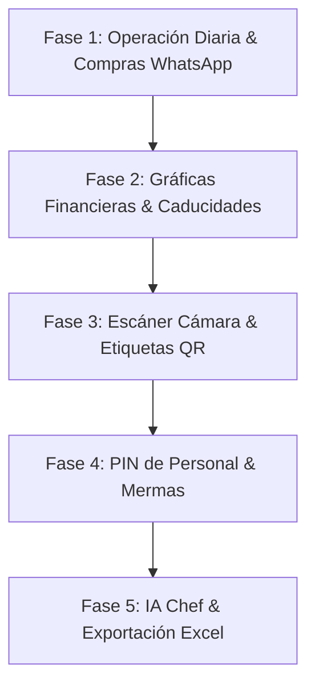

# 🏛️ ALACENA Enterprise — Auditoría Maestra y Plan de 30 Mejoras
**Documento de Arquitectura y Hoja de Ruta Ejecutiva**  
**Versión del Sistema:** v2.4.0-Titanium-Nova | **Fecha:** 11 de Octubre, 2026  
**Ambiente de Producción:** https://alacena-enterprise-prod.web.app  

---

## 1. Auditoría del Flujo Actual (Diagnóstico Operativo)

### Estado Actual del Sistema:
* **Frontend:** React 19 + Vite 8 + TailwindCSS v4 + Lucide Icons + Web Audio API.
* **Backend:** Cloud Firestore (Tier Spark $0 USD) con persistencia IndexedDB offline y Cloud Functions.
* **Diseño:** Minimalista de lujo (Deep Titanium, acentos esmeralda y púrpura de alta cocina).
* **Flujos Resueltos:**
  1. **Captura Manual Ultrarrápida:** Formulario directo sin código de barras obligatorio, con moneda en **$ MXN**, stock mínimo e ideal, y personal responsable.
  2. **Gestión de Zonas en 1 Clic:** Edición inline (✏️) en la pantalla principal para renombrar Cava, Cuarto Frío, Alacena, etc., y botón `+ Nueva Zona`.
  3. **Control de Cocina:** Deducción de ingredientes en tiempo real con costo por porción y doble campana armónica.
  4. **Bitácora de Auditoría:** Registro de cada movimiento con fecha, hora y responsable.
  5. **Versión Visible y Registro de Mejoras:** Badge permanente `v2.4.0-Titanium` con banco de prueba de sonido interactivo.

---

## 2. Catálogo de las 30 Mejoras Estratégicas

### 📊 Bloque I: Mejoras Gráficas y Visuales (UI/UX de Lujo)

1. **Dashboard de Valuación con Gráficas Interactivas:**
   * Integración de gráficas de dona y barras para visualizar el porcentaje del patrimonio invertido por categoría (Vinos vs. Carnes vs. Abarrotes) en **$ MXN**.
2. **Semáforo Visual de Caducidades con Cuenta Regresiva:**
   * Tarjetas con badges dinámicos ("Vence en 48 hrs", "Consumo preferente hoy") para evitar mermas en cuarto frío.
3. **Modo Galería Visual con Fotos de Artículos:**
   * Soporte para fotografía en alta definición de cortes de carne, etiquetas de vino y frascos de especias.
4. **Selector de Tema OLED Deep Titanium vs. Light Inmaculado:**
   * Alternancia suave entre modo noche profundo (`#090D14`) y modo día galería (`#FAFAFA`) con guardado en preferencias.
5. **Medidores de Sensores de Temperatura y Humedad:**
   * Tarjetas en tiempo real para zonas climáticas (ej. *Cava Subterránea: 14°C / 70% Humedad* y *Cuarto Frío: 2°C*).
6. **Micro-Animaciones Táctiles de Incremento y Decremento:**
   * Animaciones sutiles con feedback numérico flotante (+1 / -1) al ajustar stock en la tabla.
7. **Mapa Esquemático de Zonas Físicas:**
   * Representación gráfica visual de la casa con distribución de almacenes (Cocina, Sótano, Bodega, Bar).
8. **Indicador de Rotación de Inventario (ABC):**
   * Clasificación automática de insumos: Alta rotación (consumo diario) vs. Stock estancado (>30 días sin movimiento).
9. **Badges con Efecto Luminoso (Subtle Glow):**
   * Resaltado visual para artículos de gran valor o botellas de cava de reserva especial.
10. **Diseño Web Adaptive para Tablets de Cocina:**
    * Modo "Kitchen HUD" con botones táctiles gigantes optimizado para iPad montado en la pared de la cocina.

---

### 🍳 Bloque II: Mejoras de Operación y Control de Cocina (Tipo Restaurante)

11. **Módulo de Mermas y Desperdicio:**
    * Registro de bajas por caducidad, rotura o mal manejo, calculando el impacto financiero exacto en **$ MXN**.
12. **Escandallo Dinámico de Recetas:**
    * Cálculo automático de costo por platillo y costo por comensal al planificar banquetes o cenas familiares.
13. **Factor de Conversión Automático de Unidades:**
    * Conversor inteligente entre unidades comerciales y de cocina (de kg a gramos, de litros a tazas o mililitros).
14. **Generador Automático de Lista de Compras Inteligente:**
    * Algoritmo que compara existencia real vs. stock ideal y arma la lista de compras exacta con presupuesto estimado en MXN.
15. **Exportación de Lista de Compras a WhatsApp:**
    * Botón para enviar con 1 clic la lista formateada por WhatsApp al encargado de compras o chofer con tiendas sugeridas.
16. **Sub-Recetas y Preparaciones Base:**
    * Soporte para recetas que se convierten en insumos (ej. salsa madre, caldo de res, masa fermentada guardada en cámara fría).
17. **Toma de Inventario Ciego (Reconciliación Física):**
    * Modo de conteo donde el personal cuenta sin ver el teórico; el sistema calcula discrepancias y posibles pérdidas.
18. **Acceso Rápido por PIN de 4 Dígitos para Personal:**
    * Alternador ultrarrápido de usuario en pantalla táctil para que la cocinera o el chef firmen sin escribir contraseñas.
19. **Alertas Críticas Sonoras y Visuales en Preparación:**
    * Notificación acústica de advertencia si durante una receta se agota por completo un insumo básico.
20. **Catálogo de Proveedores con Histórico de Precios:**
    * Comparativa de precios entre tiendas (Costco vs. City Market vs. Central de Abastos) para comprar siempre al mejor costo.

---

### ⚡ Bloque III: Mejoras de Practicidad, Automatización y Uso Diario

21. **Escáner de Cámara Web y Móvil Integrado:**
    * Lector de código de barras instantáneo vía cámara web sin necesidad de pistola física de escaneo.
22. **Generador e Impresor de Etiquetas QR para Frascos y Tupperware:**
    * Impresión de etiquetas adhesivas con nombre, fecha de empaque y código QR para pegar en recipientes del cuarto frío.
23. **Atajos de Teclado Profesionales:**
    * `/` para buscar al instante, `N` para capturar nuevo producto, `C` para cocinar receta, `ESC` para cerrar modales.
24. **Exportación Ejecutiva a Excel y PDF:**
    * Descarga en 1 clic de reportes financieros de inventario en Excel (.xlsx) y PDF foliado para administración.
25. **Importación Masiva desde Excel / CSV:**
    * Carga inicial o actualización masiva de cientos de artículos en menos de 20 segundos mediante archivo de plantilla.
26. **Chef Asistente con IA ("¿Qué puedo cocinar hoy?"):**
    * Sugerencias de recetas aprovechando los ingredientes prontos a vencer en el cuarto frío y la alacena.
27. **Botón de Auto-Reabastecimiento con 1 Clic:**
    * Función que eleva automáticamente todos los artículos agotados a su stock ideal tras regresar del supermercado.
28. **Instalación PWA (Progressive Web App):**
    * Capacidad de instalarse como aplicación nativa en iPad, iPhone, Android, Mac y Windows con icono propio en pantalla de inicio.
29. **Respaldo y Descarga de Backup en JSON con 1 Clic:**
    * Copia de seguridad instantánea descargable en archivo local para tranquilidad absoluta del usuario.
30. **Sincronización de Versión y Changelog en Vivo:**
    * Indicador visible en la barra superior con actualización semántica automática y bitácora de mejoras interactiva.

---

## 3. Plan de Implementación por Etapas

### 🗓️ Etapa 1: Practicidad Diaria Inmediata (Semana 1)
* **Objetivo:** Facilitar las compras y el flujo diario.
* **Entregables:**
  * Generador automático de lista de compras con botón de envío a WhatsApp (Mejora 14 y 15).
  * Atajos de teclado profesionales (Mejora 23).
  * Auto-reabastecimiento a stock ideal con 1 clic (Mejora 27).
  * Respaldo y descarga de backup en JSON (Mejora 29).

### 🗓️ Etapa 2: Visualización Financiera y Control de Caducidades (Semana 2)
* **Objetivo:** Visibilidad de dinero y prevención de pérdidas en comida.
* **Entregables:**
  * Gráficas interactivas de valuación patrimonial y distribución por categoría en MXN (Mejora 1 y 8).
  * Semáforo de caducidades con cuenta regresiva en cuarto frío (Mejora 2).
  * Medidores de temperatura y humedad para Cava y Cuarto Frío (Mejora 5).

### 🗓️ Etapa 3: Hardware, Escáner e Impresión de Etiquetas (Semana 3)
* **Objetivo:** Velocidad de identificación en la despensa física.
* **Entregables:**
  * Escáner de códigos de barras y QR con cámara web/celular (Mejora 21).
  * Generador de etiquetas QR listas para imprimir y pegar en tuppers o botellas (Mejora 22).
  * Exportación de reportes a PDF y Excel (Mejora 24).

### 🗓️ Etapa 4: Seguridad y Control Estricto de Personal (Semana 4)
* **Objetivo:** Control total tipo restaurante con atribución inmutable.
* **Entregables:**
  * Acceso rápido con PIN de 4 dígitos para tablet de cocina (Mejora 18).
  * Módulo de Mermas y desperdicios con costeo en MXN (Mejora 11).
  * Toma de inventario físico a ciegas (Mejora 17).

### 🗓️ Etapa 5: Inteligencia Artificial y Optimización Avanzada (Semana 5)
* **Objetivo:** Automatización de alta cocina.
* **Entregables:**
  * Chef con IA para sugerencia de recetas con insumos disponibles (Mejora 26).
  * Sub-recetas y fondos base (Mejora 16).
  * Instalador PWA para pantalla completa (Mejora 28).

---

## 4. Compromisos de Calidad y Política de Mantenimiento
1. **Costo de Operación:** Se mantiene estrictamente en **$0 USD/mes** mediante el tier gratuito Spark de Firebase y hosting optimizado.
2. **Moneda Exclusiva:** Todo el sistema financiero se maneja en **Pesos Mexicanos (MXN / $)**.
3. **Respaldo Continuo:** Cada mejora se versiona semánticamente, se refleja en el modal de mejoras y se respalda en Git (`main`).
